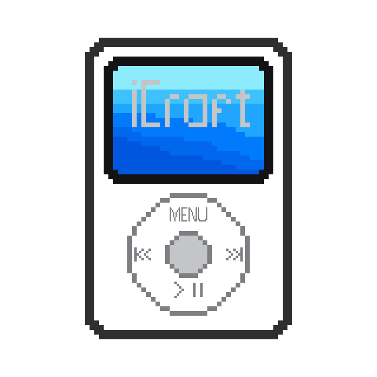

<p align="center"></p>
<h1 align="center">iCraft - Music Player<br>
	
	
	
	
	<br><br>
</h1>

<p>Welcome to iCraft - Music Player, a mod that puts an iPod into Minecraft: a click-wheel on the iPod, a docking station and speakers.</p>
<p>Play your own music, audiobooks and podcasts, or the music discs you find in the game.</p>
<p>Your files stay yours: iCraft - Music Player only reads them from a folder on your computer (or a network share) and never writes into your library.</p>

## Features

- **The iPod**: a click-wheel player in eight colours (dye it in the crafting grid), with covers, search and a now-playing panel.
- **Your own files**: Ogg, MP3, FLAC, WAV and M4A/M4B. No extra tools needed.
- **Music, audiobooks and podcasts**: separate menus. Audiobooks and podcasts remember where you stopped.
- **Music discs**: load up to 32 discs (also from other mods) into an iPod and play them like an album, with shuffle and repeat.
- **Docking station and speakers**: dock your iPod, link up to four speakers (or 2x4 speaker walls) and the music plays from the blocks.
- **Multiplayer**: players near a dock hear its music discs and only the owner controls it. Your own files are only ever heard by you.
- **Big libraries and NAS**: add extra folders (for example a mounted network share).

## Getting started

1. Put the mod jar into your `mods` folder (NeoForge 21.1.233, Minecraft 1.21.1). On a server, install it on the server **and** the clients.
2. Craft an iPod (the recipe book shows it) and start the game once.
3. Put your music into the `ipod` folder inside your game directory:

```
ipod/
  music/
    Album A/              one folder per album (cover.png / cover.jpg / folder.jpg is its artwork)
    Artist/Album B/       Artist/Album folders show up as "Artist - Album"
    Song.mp3              loose files are the "Singles" album
  audiobooks/
    My Book/              chapters as files, or one .m4b with chapter markers
  podcasts/
    My Show/              episodes as files
```

4. Right-click the iPod and pick Music, Audiobooks, Podcasts or Search.

### Extra folders and network shares

`config/icraft_music-client.toml` has three lists, `extraMusicFolders`, `extraAudiobookFolders` and `extraPodcastFolders`. Add absolute paths (for example `/mnt/nas/music`); they are merged with the local folders and show up under a separate **NAS** menu. Mount the share in your operating system first; `smb://` addresses do not work. If your launcher is a Flatpak (for example Prism on Linux), give it access to the folder as well, e.g. `flatpak override --user --filesystem=/mnt/nas/music:ro org.prismlauncher.PrismLauncher`.

## Controls

| What | How |
| --- | --- |
| Open the iPod | Right-click with it in your hand, or with an empty hand on a docked iPod |
| Click wheel | Top = back, left / right = previous / next, bottom = play / pause, middle = select, **double-click middle = stop** |
| Skip inside a track | Hold left or right on the wheel (10 seconds per step) |
| Volume | Scroll the mouse wheel over the click wheel |
| Move through lists | Scroll over the display, or the arrow keys, Enter and Backspace ||
| Load a disc | Right-click the iPod in your inventory with a music disc on the cursor |
| Take the last disc out | Right-click the iPod in your inventory with an empty cursor, or **Ctrl + right-click** with it in your hand |
| Dock it | Right-click a dock with the iPod; sneak + empty hand takes it out again |
| Link a dock | Sneak + right-click the dock with the iPod, then right-click speakers with that iPod to add or remove them |

A single speaker carries about 32 blocks; a wall of 2 wide x 4 tall speakers facing the same way carries about 64 and counts as one speaker for the dock.

## File sharing (beta, 0.1.0)

On the `beta` branch (version 0.1.0) the player who docked an iPod can play their **own** music, audiobooks and podcasts (also from a NAS folder) for everybody near the dock. The files are copied to the server, and the other players download them automatically and hear them at the right position. Music discs work without this.

**For server operators, please read:**
- It is **off by default**. Switch it on with `allowFileSharing=true` in the world's `serverconfig/icraft_music-server.toml` (stop the server first).
- It is meant for **private use** (your own server, the people you live with). With `privateNetworkOnly=true` (the default) only players connecting from a private address (192.168.x.x, 10.x.x.x, 172.16-31.x.x, localhost and the IPv6 private ranges) can share. A connection through a tunnel or reverse proxy can look like a private address, so do not rely on this setting on a public server.
- **The server stores and relays the music files of its players.** The operator is responsible for the licences of what is shared.
- Limits (all in the same file): files up to 512 MB (`maxFileSizeMb`), 2 GB cache in total (`maxCacheSizeMb`), 512 MB per player (`perPlayerQuotaMb`), unused files are deleted after 7 days (`cacheDays`), 100 tracks per list (`maxQueueItems`). The least recently used files go first, files of a list that is playing are kept. Existing config files keep their old values; delete a line to get the new default.
- Everybody in range of the dock can hear it. Every listener can silence a dock for themselves (key `\` or a double-click on the middle wheel button) and can switch the download off with `downloadSharedFiles=false` in `config/icraft_music-client.toml`.
- Where files go: `<world>/icraft_music/shared` on the server, `icraft_music-shared` in the game folder of a listener (at most 1 GB, the oldest files are removed), and the checksums of the owner's files are remembered in `icraft_music-hashes.json`.

## License

The code is under the MIT License. The artwork (everything in `src/main/resources/assets/`) is all rights reserved. See [LICENSE.md](LICENSE.md). Bundled libraries (JLayer, JAAD, an ALAC decoder) are listed in [THIRD_PARTY.md](THIRD_PARTY.md). See the [changelog](CHANGELOG.md) for what changed in each version.

See [AI-DISCLOSURE.md](AI-DISCLOSURE.md) for how AI was used in this project.

iCraft - Music Player is a fan-made mod. "iPod" is a trademark of Apple Inc.; iCraft is not affiliated with or endorsed by Apple.
